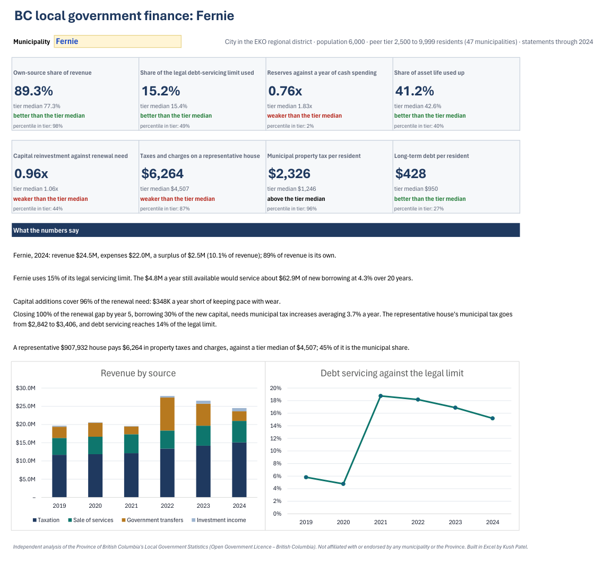
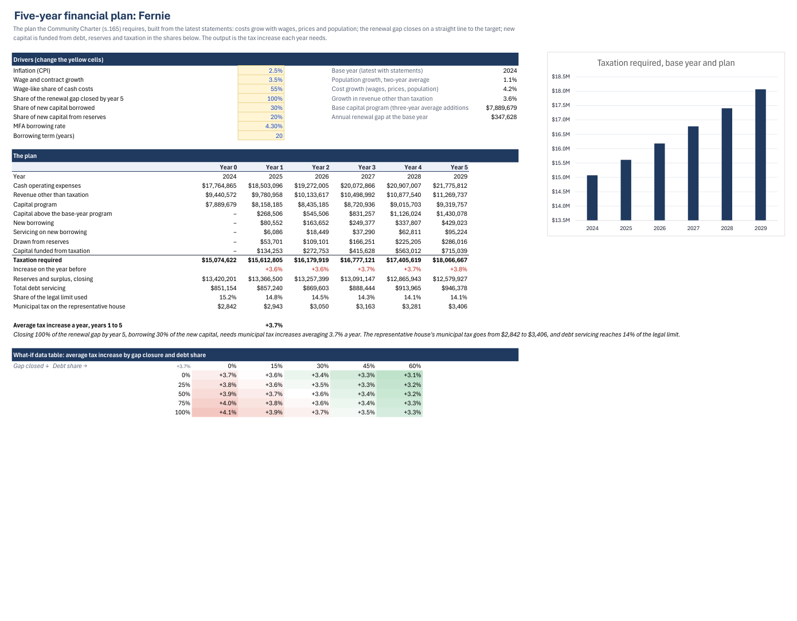
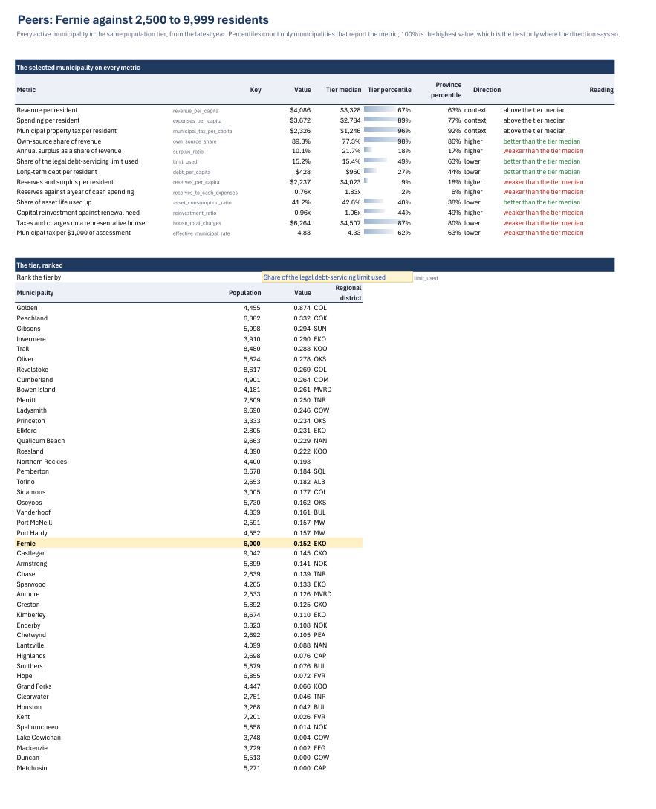
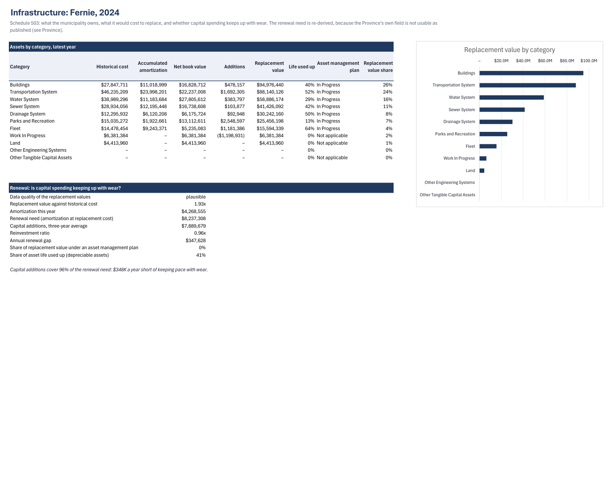
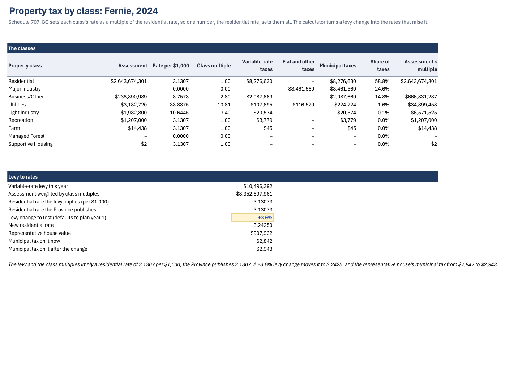
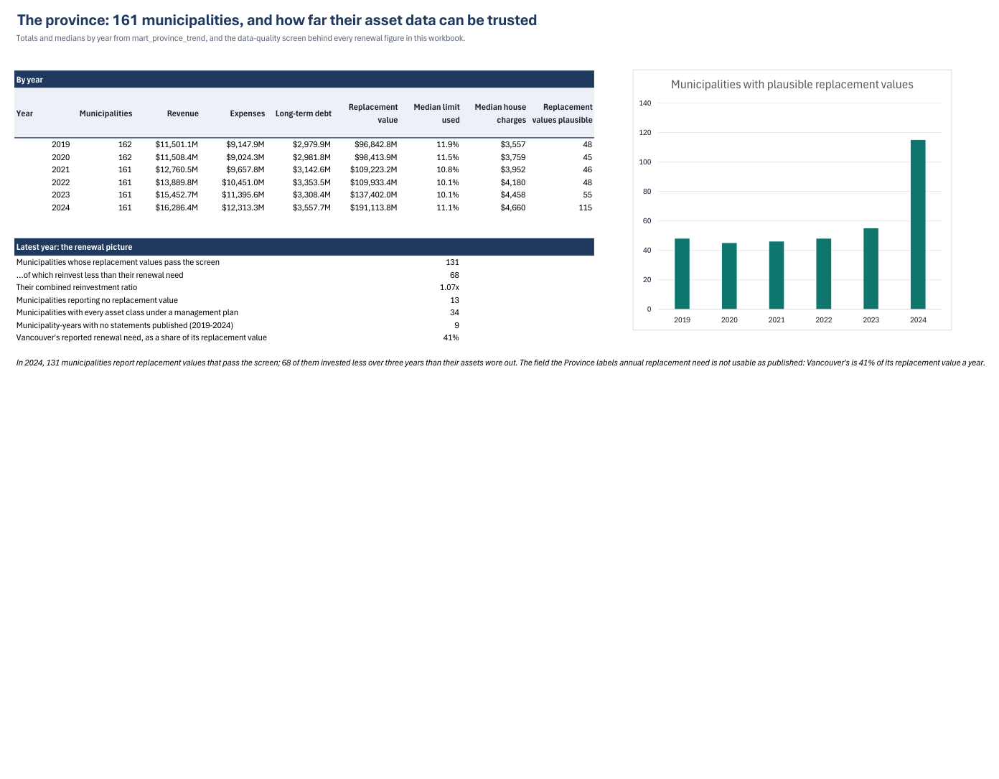
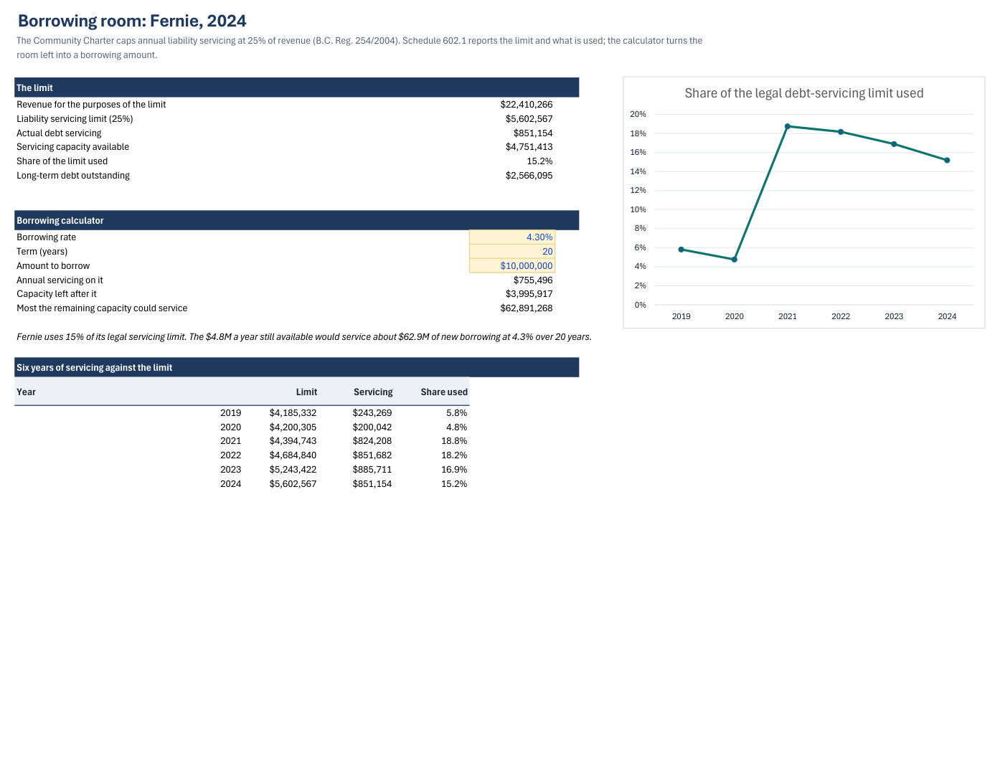

# BC local government finance: a pipeline, a dbt model and an Excel workbook on public data

[](https://github.com/KushPatel29/bc-local-government-finance/actions/workflows/ci.yml)


This project covers every municipality in British Columbia from 2019 to 2024. The data is the
Province's own *Local Government Statistics*: fifteen schedules of audited financial data a year,
published as spreadsheets. It runs in three layers:

1. **A data pipeline.** It downloads 90 files and holds each one to a written contract, because
   the files change shape from year to year.
2. **A dbt model on DuckDB.** It turns those files into indicators with **31 data tests**.
3. **An Excel workbook** a finance team would actually use. It covers:
   - peer benchmarks;
   - infrastructure renewal;
   - a five-year financial plan;
   - a levy-to-tax-rates calculator;
   - borrowing room under the legal limit.

   Pick any of the 161 municipalities and every sheet follows.

**[Download the workbook](workbook/BC_Local_Government_Finance_Model.xlsx)** (Microsoft 365 Excel) ·
**[Board pack PDF](docs/board_pack.pdf)** (10 pages, exported by Excel)

> Independent analysis of public data (Open Government Licence – British Columbia). Not affiliated
> with or endorsed by any municipality or by the Province.



## What it found

**1. BC's infrastructure is renewed at roughly the rate it wears out, on average, but half the
municipalities fall behind.** In 2024, 131 municipalities report replacement values that pass the
plausibility screen. Across them, capital additions over 2022–2024 were 1.07 times the
re-derived renewal need. The median municipality sits at 0.96, though. The **68 that invest less
than their assets wear out are $570M a year short**, combined.

**2. The Province's own "annual replacement need" field cannot be used as published.**
- Vancouver reports 41% of its replacement value a year, against a typical 2–3%.
- Before 2024 almost nobody reported replacement values at all: 101 of 162 municipalities
  reported none in 2019, against 13 in 2024.

So the model re-derives the need. It scales each municipality's own amortization from historical
to replacement cost, and only where the replacement value passes a screen (between 1× and 6×
historical cost). Every figure that depends on it says so.

**3. The published data has defects, and the pipeline finds them instead of passing them on:**

| Defect | Where | What the pipeline does |
|---|---|---|
| Population figures belonging to other municipalities (Fernie at 1,700 between 5,739 and 6,000; Kelowna at 6,948 between 149,687 and 160,693) | Schedule 201, 2022: 77 of 161 rows | Replaces a figure more than 25% from the municipality's own median with the average of the years either side. A test fails if a repair is ever needed in another file. |
| A population of 585 against about 4,400 in every other year | Northern Rockies, 2020 | Same rule, listed in `dbt/seeds/known_exceptions.csv` |
| No financial statements at all | Wells 2021–24, Greenwood 2023–24, Barriere, Hazelton and Kitimat 2024 | Listed in `dbt/seeds/missing_statements.csv`. A test fails on a new gap, and on a listed gap that gets filled. |
| Two published identities that do not hold | Anmore 2020 ($616), Maple Ridge 2019 ($844,796) | Documented exceptions. Every other published municipality-year holds to the dollar. |
| Two spellings of "not applicable", footnote digits in headers and names ("Vancouver1"), a status change (Mission became a City in 2021), two renames and a dissolution | Across years | Mapped explicitly in `pipeline/contracts.py`. Anything unmapped stops the run. |

**4. Property tax keeps climbing.** The median taxes and charges on a representative house rose
from $3,557 in 2019 to $4,660 in 2024, **+31% in five years**. Debt, by contrast, is light:
- the median municipality uses 11% of its legal servicing limit;
- 25 municipalities have no long-term debt at all.

**5. A worked example: Fernie** (a small city in the East Kootenay, population 6,000). It raises
89% of its revenue itself, which puts it in the tier's 98th percentile.

On the other side:
- its reserves cover 0.76 of a year of cash spending, the 2nd percentile of its tier;
- its representative house pays $6,264 against a tier median of $4,507;
- its capital additions cover 96% of the renewal need.

The plan sheet prices the fix. Closing the whole renewal gap by 2029, borrowing 30% of the new
capital, needs **municipal tax increases averaging 3.7% a year**. At that pace, debt servicing
falls from 15% to 14% of the legal limit, because revenue grows faster than the new servicing.

## How the layers fit

```
Province of BC (90 spreadsheets, 2019-2024)
   │  pipeline/fetch_sources.py      bronze: data/raw/, byte for byte, SHA-256 in data/sources.json
   ▼
pipeline/extract.py + contracts.py   silver: data/silver/facts.csv, 355,417 typed cells; the contract
   │                                 names every header, line, item and spelling in every year
   ▼
dbt (DuckDB)                         gold: data/gold/*.csv, staging → intermediate → marts, 31 data tests
   │                                 (identities, relationships, accepted values, documented exceptions)
   ▼
Excel workbook                       formulas, Power Query, LAMBDA and data tables over the gold tables
   │
   ▼
tests/ (pytest, 181)                 silver re-run, gold recomputed in pandas from silver, workbook held
                                     to the gold tables and to an independent pandas model
```

## What's in the workbook

| Sheet | What it answers | Excel on show |
|---|---|---|
| **Dashboard** | Eight tiles against the peer tier, five sentences written by formulas | A validated selector over 161 municipalities, `LET`, `XLOOKUP`, conditional formats, charts |
| **Profile** | Six years of revenue, expenses, position, debt, assets and tax | A named `YV` LAMBDA that looks up any column for any year |
| **Peers** | Thirteen metrics with tier and province percentiles; the tier ranked on any of them | `SORTBY(FILTER(HSTACK(...)))`, percentiles computed in the sheet and checked against dbt's |
| **Assets** | Schedule 503 by category, the renewal need and the reinvestment ratio | `FILTER`, `CHOOSECOLS`, data-quality flags carried from the pipeline |
| **Plan** | A five-year financial plan (Community Charter s.165) | Driver inputs, `PMT` over an array of borrowing tranches, a two-variable **what-if data table** |
| **Tax** | Assessment, rates and class multiples; a levy-to-rates calculator | Reproduces the Province's published residential rate from the levy and multiples |
| **Debt** | The legal servicing limit (25% of revenue), the room left, what it would borrow | `PMT`, `PV` |
| **Province** | Totals by year, the asset data-quality screen | Lookups over the province mart |
| **Checks** | 17 controls, each with a tolerance | Includes `MAP`/`LAMBDA` over the benchmark and the data table against the live plan |
| **PQ_\*** | The province's assets by category; the tier medians | **Power Query** `Table.Group`, `List.Median` |

<table>
<tr><td></td><td></td></tr>
<tr><td></td><td></td></tr>
<tr><td></td><td></td></tr>
</table>

## How it's verified

- **Bronze is what the Province published.** Every raw file's size and SHA-256 are checked against
  `data/sources.json`.
- **Silver is reproducible.** The test re-runs the extraction and compares every byte. Synthetic
  files prove that an unknown header or a missing line stops the pipeline.
- **Gold has two implementations.** dbt computes the indicators in SQL; `tests/test_gold.py`
  recomputes them in pandas straight from silver. That covers:
  - the published lines, own-source share and limit used;
  - reserves, the population repair and the renewal need;
  - every peer percentile and the province totals.
- **The workbook has two more.** It computes in Excel formulas. `model/reference.py` recomputes the
  same things in pandas:
  - the plan, row by row and year by year;
  - all 25 cells of the data table;
  - the levy-to-rates calculator, which matches the Province's published residential rate to 5
    significant figures;
  - the borrowing calculator.
- **17 in-workbook checks** cover row counts against dbt, accounting identities for the selection,
  the data table against the live plan, and Power Query against the tables it reads.
- **No hard-coded numbers.** A test walks the analysis sheets and fails on any typed number other
  than inputs and axes.
- **The tests can fail.** Closing the renewal gap over four years instead of five in the reference
  model turns 4 workbook tests red.

## Run it

```bash
pip install -r requirements.txt
python pipeline/fetch_sources.py          # bronze (network); --check reports what changed
python pipeline/extract.py                # silver
dbt build --project-dir dbt --profiles-dir dbt   # gold + 31 data tests
python -m pytest                           # any OS
```

Rebuilding the workbook needs Windows with Microsoft 365 Excel and `pywin32`. It takes about 40
seconds and also exports the board pack:

```bash
python model/build_workbook.py            # workbook/*.xlsx + docs/board_pack.pdf
python model/render_previews.py           # docs/img/*.png (needs pymupdf, pillow)
```

A scheduled GitHub Actions workflow (`refresh.yml`) re-downloads the Province's files every
month. If one changed, it rebuilds silver and gold, runs dbt's tests, and opens a pull request.

## Limits

- **The data stops at 2024.** The Province publishes a year's schedules the following year.
- **Population and per-capita figures:** BC Stats' 2024 estimates repeat 2023's for nearly every
  municipality, so per-capita figures for 2024 use 2023's population.
- **The reinvestment ratio is an upper bound on renewal.** Capital additions include growth assets
  (new roads, new facilities), not only replacements.
- **The plan is a model, not a council's budget.** It shows what closing the renewal gap costs
  under stated drivers. A real plan would add service changes, grants and the capital project list.
- **CI cannot run Excel.** It verifies the committed workbook's cached values, but it cannot
  rebuild the workbook.

## License

Code under MIT. The data is the Province of British Columbia's, under the Open Government
Licence – British Columbia.
